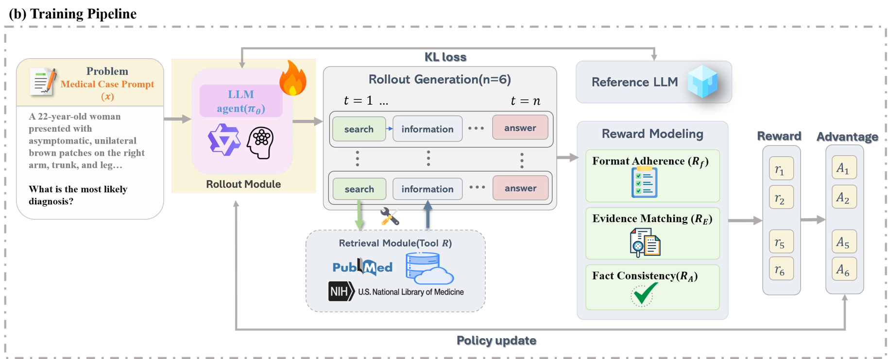
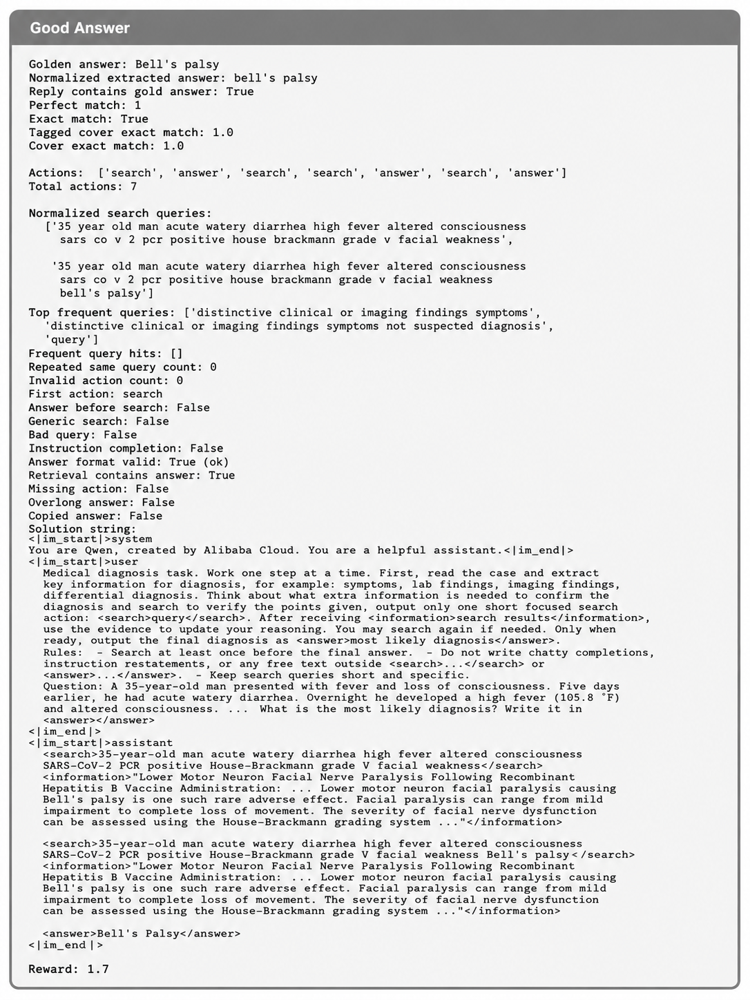

# MedSearch-R1: An Evidence-Informed Synthesis Agent for Medical Deep Research 🩺🧠

<div align="center">
  
</div>

<p align="center">
  <a href="docs/thesis.md">Thesis</a> •
  <a href="#preliminary-results">Results</a> •
  <a href="#case-example">Case Example</a> •
  <a href="https://github.com/PeterGriffinJin/Search-R1">Search-R1</a>
</p>

**MedSearch-R1** trains a medical reasoning agent to interleave **search, evidence reading, and diagnosis** through reinforcement learning. It adapts [Search-R1](https://github.com/PeterGriffinJin/Search-R1) and [veRL](https://github.com/volcengine/verl) to medical case reasoning.

This repository accompanies **“An Evidence-Informed Synthesis Agent for Medical Deep Research”**, the 2026 undergraduate thesis of **Sylvia Chung Yan Shan**, supervised by **Zuozhu Liu** at the **ZJU-UIUC Institute**.

The pipeline uses **Qwen2.5-3B-Instruct**, a **LoRA supervised fine-tuning cold start** on MedCaseReasoning, and **Group Relative Policy Optimization (GRPO)** with a medical retriever. The agent learns to generate focused queries, read retrieved evidence, and produce a final diagnosis.



*Six sampled rollouts interact with the retriever. Correctness, evidence matching, and format rewards guide GRPO updates, with KL regularization against a reference policy.*

## Links

- [Installation](#installation)
- [Quick start](#quick-start)
- [Preliminary results](#preliminary-results)
- [Case example](#case-example)
- [Inference](#inference)
- [Use your own dataset](#use-your-own-dataset)
- [Use your own search engine](#use-your-own-search-engine)
- [Features](#features)
- [Acknowledge](#acknowledge)
- [Citations](#citations)

## Installation

### Search-r1 environment
```bash
conda create -n searchr1 python=3.9
conda activate searchr1
# install torch [or you can skip this step and let vllm to install the correct version for you]
pip install torch==2.4.0 --index-url https://download.pytorch.org/whl/cu121
# install vllm
pip3 install vllm==0.6.3 # or you can install 0.5.4, 0.4.2 and 0.3.1

# verl
pip install -e .

# flash attention 2
pip3 install flash-attn --no-build-isolation
pip install wandb
```

### Retriever environment (optional)
If you would like to call a local retriever as the search engine, you can install the environment as follows. (We recommend using a seperate environment.)
```bash
conda create -n retriever python=3.10
conda activate retriever

# we recommend installing torch with conda for faiss-gpu
conda install pytorch==2.4.0 torchvision==0.19.0 torchaudio==2.4.0 pytorch-cuda=12.1 -c pytorch -c nvidia
pip install transformers datasets pyserini

## install the gpu version faiss to guarantee efficient RL rollout
conda install -c pytorch -c nvidia faiss-gpu=1.8.0

## API function
pip install uvicorn fastapi
```

## Quick start

The medical experiments use **MedCaseReasoning** and a **PubMed case-report corpus**, with **BM25** as the primary retriever.

(1) Prepare the medical QA data.

```bash
python scripts/data_process/create_train_data.py --local_dir ./data/medcase
```

The current preprocessing script selects 500 training and 200 test examples. The thesis reports 1,000 training samples and a separate evaluation of 897 cases; see [experiment details](docs/thesis.md).

(2) Build a Pyserini BM25 index for `corpus/medcase200.jsonl`, then launch the retrieval server with your index path.

```bash
conda activate retriever
python search_r1/search/retrieval_server.py \
    --index_path /path/to/medical/bm25-index \
    --corpus_path corpus/medcase200.jsonl \
    --retriever_name bm25 \
    --topk 3 \
    --host 127.0.0.1 \
    --port 8000
```

(3) Configure the medical GRPO training entry point.

[train_grpo.sh](train_grpo.sh) selects `Med-Qwen2.5-3B-Instruct-SFT-merged` and `data/medcase/{train,test}.parquet`. Supply the SFT checkpoint and reconcile the [current configuration gaps](docs/thesis.md#implementation-status) before running training. The checked-in script is an experimental configuration, not a verified reproduction of the thesis run.

## Preliminary results

### Medical diagnosis

Thesis Table 4.1, evaluated on **897 cases**. Predictions are extracted from `<answer>...</answer>` tags.

| Setting | Retriever | Answer tag | Normalized EM | Flexible Match |
| --- | --- | ---: | ---: | ---: |
| Base model | None | 98.77% | 3.01% | 7.25% |
| Base model | BM25 | 100.00% | 7.36% | 8.34% |
| SFT model | None | 99.55% | 2.79% | 7.47% |
| SFT model | BM25 | 99.78% | 1.34% | 7.92% |
| Multi-turn RL agent (checkpoint 75) | BM25 | 99.66% | 6.02% | 11.04% |
| Multi-turn RL agent (checkpoint 90) | BM25 | 97.65% | **9.70%** | **17.73%** |

Checkpoint 90 improves Normalized EM by **6.69 percentage points** and Flexible Match by **10.48 percentage points** over the base model without retrieval. Single-pass retrieval does not consistently help the SFT model.

**Normalized EM** is the primary answer metric; **Flexible Match** allows relaxed matching. Answer-tag presence measures formatting, not diagnostic accuracy. [CSV](docs/results/diagnosis.csv)

### Retriever comparison

Thesis Table 4.3, top-10 retrieval.

| Retriever | Hit Rate | MRR | Precision |
| --- | ---: | ---: | ---: |
| BM25 | **0.997** | **0.995** | **0.231** |
| MedCPT | 0.790 | 0.680 | 0.135 |
| E5 | 0.826 | 0.677 | 0.122 |

BM25 performs best on the entity-rich medical cases. Increasing BM25 retrieval from top-10 to top-64 raises hit rate from 0.997 to 0.998 while reducing precision from 0.231 to 0.046. The retrieval ablation's top-k values are separate from the agent's top-3 rollout setting.

[Full top-k results](docs/results/retrieval.csv). MAP and NDCG are transcribed as reported; several exceed 1, so the thesis bases its comparison primarily on Hit Rate, MRR, and Precision.

### Successful trajectories

The thesis reports **5,849 perfect exact-match trajectories**. Case-oriented sections account for **64.1%** of retrievals in these trajectories, followed by treatment (**12.6%**). Common patterns include symptom-first search, diagnosis confirmation, and case-to-concept verification. Later training showed reduced trajectory diversity and signs of policy collapse.

[Section distribution](docs/results/sections.csv) · [Training details](docs/thesis.md)

## Case example

A supplied successful example ends with `<answer>Bell's Palsy</answer>` after two visible searches: an initial findings-based query followed by a query that adds the candidate diagnosis.

```text
Search 1: 35-year-old man acute watery diarrhea high fever altered consciousness
          SARS-CoV-2 PCR positive House-Brackmann grade V facial weakness
Search 2: [same findings] Bell's palsy
Answer:   Bell's Palsy
```

The example log reports **exact match: True**, **Cover EM: 1.0**, **retrieval contains answer: True**, and **reward: 1.7**. The screenshot abbreviates the original case and retrieved passages; this is an illustrative logged result.

<details>
<summary>View case example</summary>



</details>

## Inference

[infer.py](infer.py) is the inherited general-QA demo. To use a medical checkpoint, configure its `model_id`, `question`, prompt, and retrieval endpoint. A released thesis checkpoint and a medical evaluation runner are not included in this checkout.

## Use your own dataset

The medical preprocessing entry point is [create_train_data.py](scripts/data_process/create_train_data.py). It loads `zou-lab/MedCaseReasoning` and creates records in the Search-R1 format:

```python
data = {
    "data_source": "medcase",
    "prompt": [{"role": "user", "content": medical_case_prompt}],
    "ability": "fact-reasoning",
    "reward_model": {
        "style": "rule",
        "ground_truth": {"target": final_diagnosis},
    },
    "extra_info": {"split": split, "index": index},
}
```

The policy emits `<search>query</search>` or `<answer>diagnosis</answer>`; the environment returns evidence in `<information>...</information>`. Retrieved tokens are masked from policy optimization. A final answer should follow at least one search.

## Use your own search engine

The retriever runs separately from RL training and exposes `http://127.0.0.1:8000/retrieve`:

```json
{"queries": ["focused clinical findings"], "topk": 3, "return_scores": true}
```

Local corpora use JSONL records with `id` and `contents` fields. See [retriever documentation](docs/retriever.md), [retrieval server](search_r1/search/retrieval_server.py), and [evidence formatter](search_r1/search/evidence_formatter.py). BM25, E5, and MedCPT are compared in the thesis; multi-retriever fusion, live literature search, and multimodal diagnosis are future work.

## Features

- Medical cold start with Qwen2.5-3B-Instruct and LoRA SFT.
- GRPO with iterative retrieval and structured search/answer actions.
- Rewards for answer correctness, evidence support, and format adherence.
- Retrieved-token masking during policy optimization.
- Medical retriever and context-size ablations.
- Analysis of successful diagnostic search trajectories.

Results are thesis-reported and have not been independently rerun for this documentation update. This is a research prototype without clinical validation.

## Acknowledge

This medical adaptation builds on [Search-R1](https://github.com/PeterGriffinJin/Search-R1) by Bowen Jin and collaborators and [veRL](https://github.com/volcengine/verl). The upstream framework also acknowledges [DeepSeek-R1](https://github.com/deepseek-ai/DeepSeek-R1), [TinyZero](https://github.com/Jiayi-Pan/TinyZero), and [RAGEN](https://github.com/ZihanWang314/RAGEN).

Thanks to **Zuozhu Liu** for thesis supervision and **Fucheng Niu** for research guidance. The [inherited experiment logs](docs/experiment_log.md) describe upstream Search-R1 experiments.

## Citations

```bibtex
@misc{chung2026evidence,
  title={An Evidence-Informed Synthesis Agent for Medical Deep Research},
  author={{Sylvia Chung Yan Shan}},
  howpublished={Undergraduate thesis, Zhejiang University--University of Illinois Urbana-Champaign Institute},
  year={2026}
}

@article{jin2025search,
  title={Search-r1: Training llms to reason and leverage search engines with reinforcement learning},
  author={Jin, Bowen and Zeng, Hansi and Yue, Zhenrui and Yoon, Jinsung and Arik, Sercan and Wang, Dong and Zamani, Hamed and Han, Jiawei},
  journal={arXiv preprint arXiv:2503.09516},
  year={2025}
}

@article{jin2025empirical,
  title={An Empirical Study on Reinforcement Learning for Reasoning-Search Interleaved LLM Agents},
  author={Jin, Bowen and Yoon, Jinsung and Kargupta, Priyanka and Arik, Sercan O and Han, Jiawei},
  journal={arXiv preprint arXiv:2505.15117},
  year={2025}
}
```

## License

[Apache License 2.0](LICENSE). Existing copyright and attribution notices are retained.
