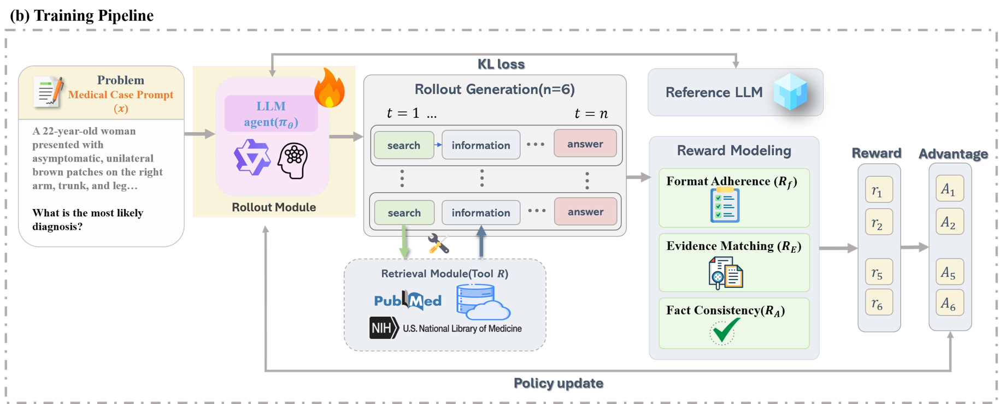

# Senior thesis

**An Evidence-Informed Synthesis Agent for Medical Deep Research**  
**Author:** Sylvia Chung Yan Shan  
**Supervisor:** Zuozhu Liu  
**Institution:** Zhejiang University–University of Illinois Urbana-Champaign Institute  
**Year:** 2026

This research summary and the result tables are based on Chapters 3–5 and the appendix of the author-supplied senior thesis. The original thesis PDF is not bundled here.

## Research questions

1. Does retrieved evidence improve diagnosis compared with direct inference?
2. How do retriever choice and retrieved context size affect performance?
3. Which search and reasoning patterns appear in successful trajectories?

## Training pipeline

The agent is initialized through medical SFT, then optimized using GRPO. Each case generates a group of candidate trajectories that alternate between search actions and retrieved evidence before producing a final diagnosis. Group-relative rewards provide advantages; KL regularization limits drift from the reference policy. Retrieved text is excluded from policy-gradient and KL-loss terms in the thesis formulation.

### SFT settings

| Parameter | Thesis appendix |
| --- | --- |
| Base model | Qwen2.5-3B-Instruct |
| Dataset | MedCaseReasoning |
| Adaptation | LoRA, rank 32, alpha 16, dropout 0.1 |
| LoRA targets | Q/K/V/O projections |
| Learning rate | 2 × 10⁻⁵ |
| Epochs | 1 |
| Per-device batch / gradient accumulation | 1 / 16 |
| Effective batch | 64 across 4 GPUs |
| Optimizer / schedule | AdamW / linear, warmup ratio 0.1 |

### GRPO settings

| Parameter | Thesis methodology / appendix |
| --- | --- |
| Initialization | Med-Qwen2.5-3B-Instruct-SFT-merged |
| Training strategy | FSDP |
| Batch / actor mini-batch / micro-batch | 32 / 16 / 4 |
| Prompt / response / observation limit | 5,000 / 500 / 500 tokens |
| Samples per case | 6 |
| Temperature / top-p / repetition penalty | 0.6 / 0.9 / 1.1 |
| Rollout dtype | float16 |
| KL coefficient / clip ratio / gradient clip | 0.001 / 0.2 / 1.0 |
| Maximum turns / invalid-action threshold | 3 / 4 |
| Retrieved passages | Top-3 |
| Evidence formatting | 1,200 characters, up to 3 sentences |
| Retrieval endpoint | `http://127.0.0.1:8000/retrieve` |
| Save / validation interval | 15 / 10 steps |
| Hardware | 4 GPUs |

Chapter 4 describes training on 1,000 samples for 3 epochs. The appendix lists a trainer configuration of 5 epochs and 300 steps. These are separate reported descriptions; the thesis does not fully reconcile them.

### Reward design

The thesis combines correctness, retrieval support, formatting, bonuses, and penalties:

- Exact-match answer with valid formatting and a prior search: correctness reward 2.0; exact match with valid formatting: 1.0.
- Partial token coverage: coefficient 0.6; gold answer contained in the response: 0.8.
- Gold answer present in retrieved information: retrieval reward 1.0.
- Valid tag sequence: format reward 0.2; first action is search: bonus 0.2.
- Penalties discourage invalid actions, repeated or generic queries, empty or copied answers, and format violations.

These are thesis descriptions, not a claim that the checked-in launcher wires every term into the active reward function. The supplied case example reports a reward of 1.7 under its own logged evaluation.

## Results

- [Diagnostic ablation, Table 4.1](results/diagnosis.csv): six settings, each evaluated on 897 cases. Percentages are stored on a 0–100 scale.
- [Retriever ablation, Table 4.3](results/retrieval.csv): all 12 retriever/top-k settings. E5 uses k=24 in its second row; BM25 and MedCPT use k=20. MAP and NDCG values are preserved verbatim, including values above 1, as flagged in the thesis.
- [Retrieved sections, Table 4.4](results/sections.csv): section distribution within the 5,849 perfect exact-match trajectories. Blank counts mean the thesis did not report a count. Case/`case`/`CASE` are merged for the section distribution.

The thesis reports an average of 1.53 unique sections per successful case before section-name normalization. Successful patterns include a single discriminative search, symptom-first and diagnosis-second confirmation, outcome-oriented follow-up, case-to-concept verification, imaging-driven search, and differential-diagnosis comparisons.

## Implementation status

The repository contains medical preprocessing, corpus artifacts, retrieval components, and an experimental GRPO launcher. The following differences were identified when aligning the documentation with the thesis:

- `scripts/data_process/create_train_data.py` currently samples 500 training and 200 test cases; these do not match the thesis's 1,000-sample training description or 897-case evaluation.
- `train_grpo.sh` currently uses 6 GPUs, 8 sampled agents, temperature 0.2, 4 turns, and 2,048/512/512 prompt/response/observation limits. These differ from the thesis settings above.
- The launcher invokes `verl.trainer.main_ppo_format`, whose reward dispatcher does not currently accept the `medcase` data-source identifier emitted by the medical preprocessing script.
- Several launcher overrides are absent from `verl/trainer/config/ppo_trainer.yaml`; Hydra configuration and reward-term wiring need reconciliation before a medical training run.
- `infer.py` defaults to an upstream general-QA checkpoint and question. Thesis SFT/RL checkpoints, the diagnostic evaluation runner, and the complete 5,849-trajectory release are not included in the inspected checkout.

The thesis settings are documented without replacing current experimental code with an unverified reconstruction. Results have been transcribed and checked against the thesis; GPU training and benchmark evaluation have not been rerun.

## Discussion and future work

The thesis identifies limited corpus coverage, dependence on one primary retriever, and reduced trajectory diversity during later RL training. Proposed extensions include complementary retrievers, knowledge-conflict resolution, broader medical sources, real-time literature retrieval, and multimodal diagnosis. The current work uses a fixed case-report corpus and text representations of clinical findings.
